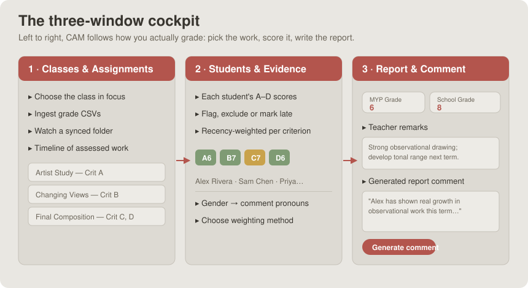
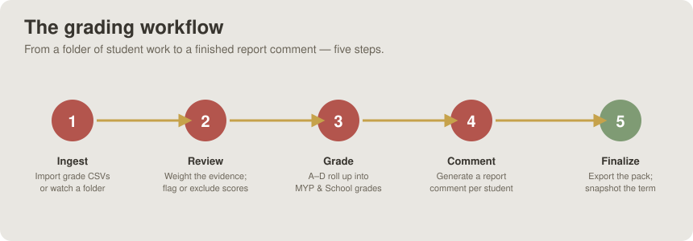
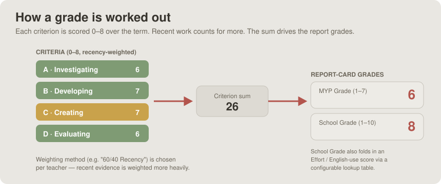

# User manual

A short, illustrated tour of Criterion Assessment Metrics (CAM) for the teacher
using it day to day. If you haven't installed it yet, start with the
[Setup guide](SETUP.md).

For the short, print-friendly walkthrough shipped with the Windows portable
bundle, use the [CAM Quick Guide](QUICK_GUIDE.md). It covers first start, class
setup, marks, exam grading, reports, backups and the two troubleshooting
launchers. This manual provides the fuller explanation behind those tasks.

> Everything shown below runs on the bundled **fictional sample class** — the
> students, grades and comments are invented.

---

## The three-window cockpit

CAM lays the whole grading job out on one screen, in three panels that read left
to right — the same order you actually work in: **pick the work → score it →
write the report.**

| Window | You use it to… |
|---|---|
| **1 · Classes & Assignments** | Switch between the classes you teach, import grade CSVs, watch a synced folder for new work, and see the timeline of assessed assignments. |
| **2 · Students & Evidence** | See every student's Criterion A–D scores, flag or exclude a piece, mark work late, and set the weighting method. Each student's gender (optional) sets the pronouns used in their comment. |
| **3 · Report & Comment** | Read the final criterion grades — plus, if you switch them on in Settings, the school-specific **MYP Grade** / **Effort** / **School Grade** — jot teacher remarks, and generate the report-card comment. |

You can drag the column widths and panel heights to suit your screen; those
preferences are saved to your device only.

---

## The daily workflow

1. **Ingest.** In Window 1, import a grade CSV (or point CAM at a folder it
   watches). Scores are matched to students and dated automatically.
2. **Review.** In Window 2, glance over the evidence. Exclude a piece that
   shouldn't count, flag a "wrong assignment" upload, or mark something late —
   without deleting anything.
3. **Grade.** CAM computes a recency-weighted suggestion for each criterion and
   rolls them into the report grades (see below).
4. **Comment.** In Window 3, generate a report-card comment. With no setup this
   copies a ready-made prompt to your clipboard; with an API key it writes the
   comment in place.
5. **Finalize.** Export the mail-merge pack and snapshot the term so next term's
   comments can build on this one.

---

## How a grade is worked out

Each MYP criterion is scored **0–8**, and a student collects several scores per
criterion across the term. CAM weights **recent** work more heavily and sums the
per-criterion results — that criterion picture is always the core of the grade.

- The **weighting method** (for example *"60/40 Recency"*) is yours to choose in
  Window 2.
- **Optional school-specific roll-ups.** Some schools also report banded grades
  on top of the criteria. These are **off by default**; turn on the ones you use
  in **⚙ Settings → Report-card grades**:
  - **MYP Grade (1–7)** — looked up straight from the criterion sum.
  - **Effort / English-use** — a per-student, per-term score you set (its range
    is configurable in the same settings section).
  - **School Grade (1–10)** — folds the Effort/English-use score in with the
    criterion sum through a lookup table.

  When enabled they appear in Window 3 and in the report cards; when off, CAM
  reports the criterion grades alone.

Nothing here is a black box: every score that feeds a grade is visible in Window
2, and you can exclude or re-weight any of it.

---

## Report-card comments

CAM drafts a comment from the same evidence you can see on screen — it is
pronoun-aware (from the optional gender field) and term-aware (it can build on a
previous term's finalized comment).

- **Clipboard mode (no setup).** CAM assembles the prompt; you paste it into any
  chatbot and paste the result back. Nothing leaves your machine automatically.
- **API mode (optional).** Add a Claude or Gemini API key in the comment
  settings and CAM writes the comment in one click. See
  [Setup · report-comment AI](SETUP.md#6-optional-report-comment-ai).

Always read and adjust a generated comment before it goes on a report — it is a
first draft built from your grades, not a replacement for your judgement.

---

## The grading workspace (optional)

For grading student work that syncs in from Google Drive / OneDrive, CAM can
launch a companion **grading workspace**: a thumbnail grid of a whole class's
submissions and an anonymous grading mode (grade without seeing names to reduce
bias). It hands finished grades back to the dashboard automatically. Scanned
exams are graded in CAM2 instead (see [Grading exam papers](#grading-exam-papers)). Setup is in
[Setup · the grading workspace](SETUP.md#7-optional-the-grading-workspace--google-drive).

---

## Grading exam papers

Scanned paper exams are graded in **CAM2 Exam Grading**, which comes with CAM
and opens in its own browser tab. CAM2 does the scans, the question boxes and
the grading; CAM brings the results into the gradebook. This section walks the
whole loop.

### 1 · Create the exam and open it in CAM2

In Window 1, use **Add assignment / exam** and choose **Exam**. Click the exam in
the list, then **🛠 Exam setup / Grade**. CAM2 opens with the exam name, your
class list and the save folder already filled in. The exam is saved in the class
folder, under `exams/<exam name>/` (scans included), so any computer that syncs
the class folder can open it again with the same button.

### 2 · Grade it in CAM2

CAM2 guides you through five steps. It explains each one on screen; the main
points are:

- **① Exam & scans.** Choose the scans: the whole class in one PDF from the
  photocopier (or a few batches), one file per student, or phone photos.
  Booklets scanned open on A3 are put back in page order, and turned, missing or
  extra pages can be fixed on screen. Late papers can be added any time.
- **② Set up questions.** Draw a box around each answer on the first paper
  (several boxes per question if an answer runs over). Choose **Marks** (points
  per question, added up) or **Rubric** (a level from your own rubric, for
  example MYP 0–8). In Rubric mode a question can be assessed on more than one
  criterion. For questions where students choose (for example "answer 2 of 3"),
  pick **Count the best N** or **I choose which count**.
- **③ Match names.** Each paper's handwritten name is shown beside your class
  list from CAM. Match each paper to a student.
- **④ Grade.** One question at a time across the class: large mark buttons or
  rubric band cards, **Not answered** kept apart from ungraded, **Quick
  comments** (the keyword checklist) and a comment per answer. **Hide student
  names** and **Shuffle papers** (a new order for each question, papers shown as
  `01`, `02`, …) reduce bias. If a box was drawn in the wrong place, **✎ Adjust
  this box** fixes it and slices only that question again; every grade is kept.
- **⑤ Review & export.** Check the totals, choose which answers count for any
  student who answered too many (with **I choose which count**), and make the
  student PDF reports and the Excel gradebook for this test if you want them.
  Then click **✓ Grading finished — send to CAM**.

Every grade is saved the moment you give it. You can close CAM2 and come back
with **🛠 Exam setup / Grade**; it reopens at the same question and paper.

### 3 · Bring the results into the gradebook (Window 1)

A few seconds after you send, CAM reads the exam (it never changes the files in
the exam folder; an exam sent while CAM was closed is read the next time CAM
starts). The results appear in Window 1's **📝 Exam grading** panel and in each
student's marks list in Window 3, with every question's mark (or Not answered),
which choice answers counted and the comment. If you change grades in CAM2
afterwards, click **Send again**; grades you already applied in CAM are kept.

- **Marks exam.** The panel shows each student's raw total (`31/45`) and a 0–8
  grade, suggested in proportion to the total. Pick the criterion it counts
  toward, adjust any grade, and click **Apply grades to gradebook**.
- **Rubric exam.** Each CAM2 rubric is mapped to a CAM criterion (a rubric
  named "Criterion B" or "基準B" is mapped to B for you; the choice is
  remembered per exam). Each student's final level per rubric, as worked out in
  CAM2, is shown to confirm or adjust. A rubric whose top level is not 8 (for
  example 0–4) is scaled to 0–8. **Apply grades to gradebook** writes one grade per mapped criterion.

A paper that is not finished in CAM2 (an ungraded question, or a choice still
waiting for you to pick) shows as **not finished** and is left out of the class
average until you finish it and send again.

**Matching a leftover paper (🧩).** A paper you did not match to a student in
CAM2 is never turned into a new student. It waits in a pool, and every student
who is missing that exam shows a **🧩 `<exam>` — N unmatched work** button in
their Window 2 ⚠ popover. Click it to see the leftover papers by their
handwritten name, each with its raw total, and click the one that is theirs. CAM
files the result under that student and remembers the match the next time the
exam is sent.
Clicking the exam in Window 1 also shows each student's handwritten name beside
their result, so a paper matched to the wrong student is easy to spot (fix the
match in CAM2 and send again).

### 4 · Deleting an exam permanently

Archiving an exam (Window 1) is soft and reversible: **Restore** brings it back
untouched. **Delete permanently** in the Archived dialog removes the exam and
its grades from CAM and moves its CAM2 folder into
`exams/_deleted/<date and time> <exam>/` in the class folder, so CAM does not
read it again. The scans and grades in that folder are kept; delete it
yourself when you are sure you no longer need it.

### Exams graded before CAM2

Exams graded in the old grading workspace keep their results and grades in CAM.
The old exam screens are gone, and an old exam export CSV left in a class
folder is ignored (and refused by **Upload & stage files**). Grade new exams
in CAM2.

---

## Reporting a custom class or homeroom

Keep marking and generating comments in the main teaching groups. In **System
deliverables**, **Report for** chooses either the current teaching group or a
saved custom reporting class. This selection leaves the main class, focused
student, term and comment-generation scope in place. A fresh session defaults
to the current teaching group.

Choose **Manage reporting classes** to create a named list or edit an existing
one. Select source teaching groups, use **Select all** for a group if helpful,
then tick/untick individual students. The table shows name, ID/email and source
group; search filters the table while keeping selections. Choose one source
group for each student ID. Students with no marks or only draft feedback can
be selected too. The same student can belong to several saved lists.

Use unique position numbers or the up/down arrows for exact register order.
Choose Manual, Surname A–Z, Given name A–Z, Gojuon or Email for output order.
These sorts leave the saved manual order and teaching-group roster order intact.
**Save reporting class** saves the complete edit; **Cancel** discards it. Deleting
a reporting class deletes only its saved list, leaving students and grades
available in their teaching groups.

The scope caption shows member count, source groups and selected term. Resolve
any missing/archived members, ambiguous legacy evidence or conflicting source
subject/year/MYP settings before building that custom report. Other reports
remain available. Different assignment counts and unfinished grading do not
block export: each student's expected work and grades come from their own
teaching group, with CAM's usual missing, excused and awaiting-grade policies.

All five deliverables use the selected members and order. Custom Excel includes
teaching-group provenance and subset assignment statistics; Raw Scores retains
source-group history across terms. It omits Classroom Entry, which remains a
teaching-group tool for pasting marks back to Classroom. Report cards show the
reporting class and source teaching group, with that group's unit plan. Custom
single cards have their own member selector. The mail-merge ZIP retains school
email filenames, email warnings and withheld-grade rules. Class comments collect
saved all-term comments and teacher remarks unchanged, without generating text.

Build each file, then download it. Editing membership, order, names, grades,
comments or report settings invalidates previously built downloads. Downloaded
files remain snapshots. Reporting lists apply across terms within the current
database; term backups do not recover them, so keep whole-database backups too.
Update CAM on every device that writes the shared database before using these
lists. Automatic workbook-to-roster mapping, transfer history and multi-year
rollover are outside this feature; initial membership is selected manually.

## Where your data lives

Your real gradebook is a single `acm_database.json` in a folder **you** choose —
ideally a cloud-synced one so every device shares it and it's backed up. CAM
never stores real student data inside the program folder. To change the
location, open **⚙ Settings → Custom database location**
([details](SETUP.md#5-point-cam-at-your-own-data)).

CAM remembers the identity of every database location used on this device. If an
established cloud database temporarily disappears, a different database appears
at the same path, or the sync client creates a likely conflicted copy, CAM enters
**read-only quarantine** instead of creating or overwriting anything.

- For a missing database or conflict sibling, close other CAM sessions, allow
  synchronization to finish, review the paths shown, and press **Retry database
  check**. CAM never merges, renames, selects, or deletes conflict copies.
- For a different database identity, verify the displayed counts and type
  `USE THIS DATABASE` only when the replacement is intentional. This updates the
  current device's binding without writing to the database.
- If a conflict is discovered while saving, CAM preserves pending work in a
  verified `conflict-recovery` file. If that recovery copy cannot be verified,
  leave the CAM session open and retry recovery before reloading or closing it.
- If CAM reports an unsupported database version or failed structural
  validation, it has loaded no partial gradebook and changed no shared bytes.
  Restore a known-good `bak-session`, `bak-auto`, or cloud version, or use the
  newer CAM release that created the schema. The displayed paths identify only
  record locations; they never show student data.

CAM saves only when gradebook content or durable settings actually change.
Ordinary screen reruns do not advance the database revision; pressing **Save
now** with nothing new reports **No changes to save**. Before the first changing
save to each database used in an app session, CAM also creates a verified
`acm_database.json.bak-session-*` copy beside the database. These automatic
session snapshots preserve the exact pre-save database, use collision-proof
names, and are never automatically deleted.

## Backing up and restoring a term

Under **⚙ Settings → 🗄 Term backup & restore** you can take a deliberate,
end-of-term snapshot of one whole term and, if disaster strikes, put it back.

**Back up a term.** Pick a **backup folder** (anywhere you like — a USB stick or
a non-cloud folder is fine, for an off-site copy) and a **term**, then press
**⬇ Back up term**. CAM writes one self-describing file,
`cam_term_backup_<term>_<date-time>.json`, holding everything it knows for that
term: assignments, grades, exam results, overall comments, effort scores and the
On/late/excused settings. It only ever writes *outside* your database, so
backing up can never harm your live data. Do this at the end of each term.

**Restore a term** — a rescue tool, not an editing tool. Reach for it only if
your database has been damaged: normally you'd just edit the data directly.
First recover the file itself if needed (from your cloud's version history or a
`.bak` beside it), *then* use restore to recover a term's finer detail. Press
**⬆ Restore from backup…**, choose a backup file, and CAM shows a **preview** of
exactly what would change — class by class — plus the date the backup was made.

> ⚠ Restore **replaces that whole term**. Anything you entered for that term
> *after* the backup was made is **not** in the file and will be lost. Every
> other term is left untouched.

To go ahead you type `RESTORE Term 1` (matching the term) to confirm. CAM writes
an automatic safety copy of your current database first, then restores. Your
teacher remarks and final-grade overrides are only *filled in where blank*, so
restoring one term never overwrites another term's remarks.
